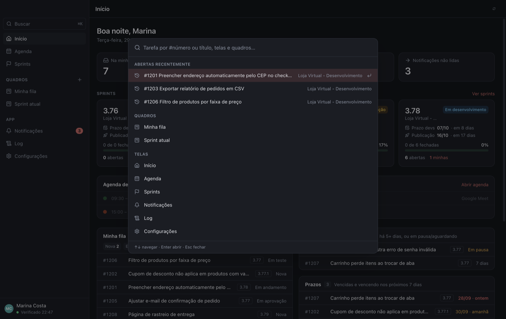
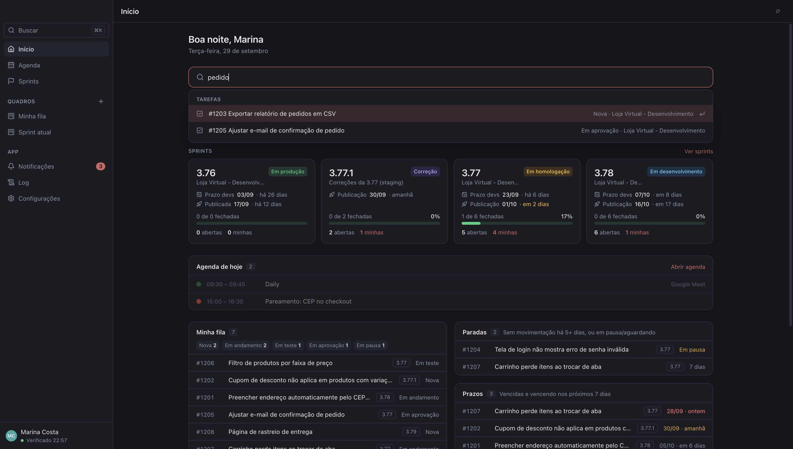
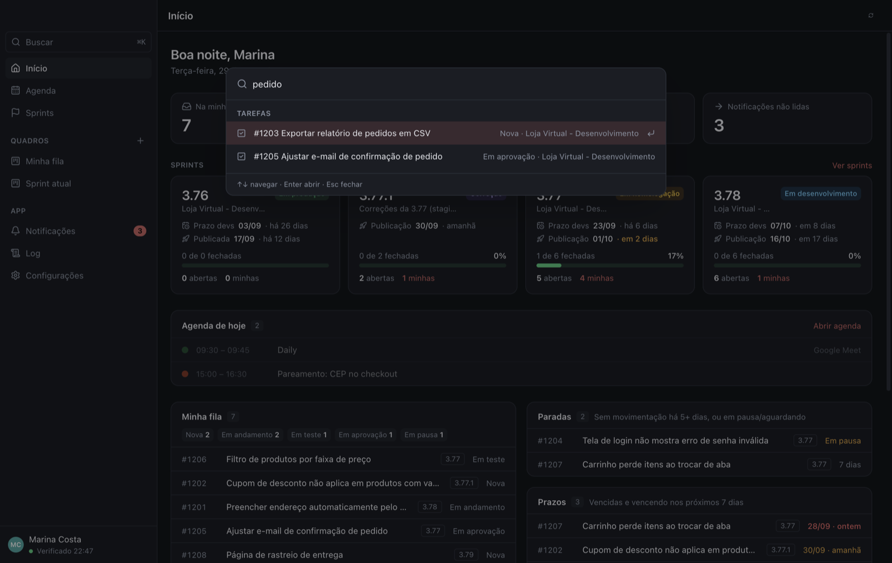
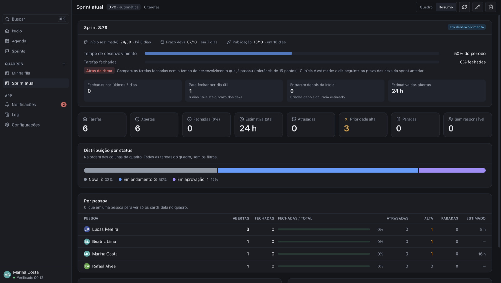
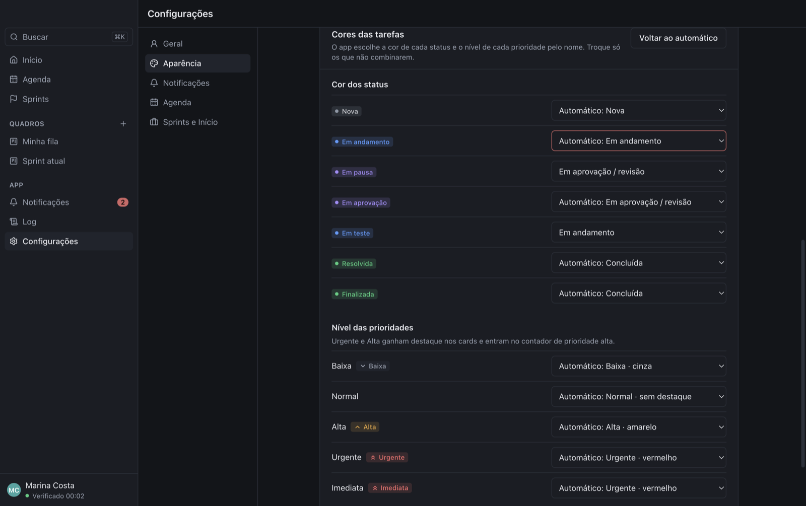

# Refined Redmine — Manual do usuário

O Refined Redmine é um app de desktop (macOS e Windows) que fica por cima do Redmine da empresa. Ele junta um painel com o seu dia, quadros kanban que mudam o status no Redmine ao arrastar, uma visão das sprints, uma agenda com lembretes e notificações do sistema operacional.

Não há servidor próprio: o app fala direto com o Redmine usando a sua chave de API, e tudo o que é local (quadros, agenda, histórico de notificações) fica salvo só no seu computador.

> As capturas de tela deste manual usam dados fictícios (projeto "Loja Virtual", usuária "Marina Costa").

## Sumário

1. [Primeiros passos](#1-primeiros-passos)
2. [Início](#2-início)
3. [Quadros kanban](#3-quadros-kanban)
4. [Detalhe da tarefa](#4-detalhe-da-tarefa)
5. [Sprints](#5-sprints)
6. [Agenda](#6-agenda)
7. [Notificações e monitores](#7-notificações-e-monitores)
8. [Log](#8-log)
9. [Configurações](#9-configurações)
10. [Atalhos e perguntas frequentes](#10-atalhos-e-perguntas-frequentes)

## 1. Primeiros passos

### Instalar

O passo a passo (macOS e Windows, com os avisos de segurança do sistema na primeira abertura) está em [Instalar o Refined Redmine](INSTALACAO.md). Versões novas são instaladas por cima da anterior; quadros, agenda e preferências são mantidos.

### Conectar ao Redmine

1. Em **URL do Redmine**, informe o endereço que você usa no navegador (ex.: `https://redmine.suaempresa.com.br`).
2. Em **Chave de acesso à API**, cole a sua chave. No Redmine: **Minha conta → Chave de acesso à API → Mostrar**.
3. Clique em **Conectar**.

A chave é guardada criptografada pelo sistema (Keychain no macOS, DPAPI no Windows) e nunca sai do seu computador, a não ser nas chamadas ao próprio Redmine.

### Confirmar as notificações

Enquanto as notificações não estiverem confirmadas, o app abre a janela **Confirmar notificações**. Clique em **Enviar notificação de teste** e responda **Apareceu** ou **Não apareceu**. A confirmação é necessária porque o sistema não avisa o app quando descarta uma notificação (por exemplo, com as notificações do app desligadas nos Ajustes).

- **Não apareceu**: o app mostra onde ligar as notificações. No macOS, **Ajustes do Sistema → Notificações → Refined Redmine → Permitir notificações** (estilo **Alertas** ou **Faixas**); no Windows, **Configurações → Sistema → Notificações**. Depois clique em **Testar de novo** e confirme.
- Dá para refazer o teste a qualquer momento em **Configurações → Notificações → Enviar notificação de teste**.

### Bandeja do sistema

Fechar a janela não encerra o app: ele continua na bandeja (barra de menus no macOS), verificando o Redmine e disparando lembretes. Pelo ícone da bandeja você abre o app, a Agenda ou as Notificações, força uma verificação (**Verificar agora**) ou sai (**Sair**).

## 2. Início

O painel resume o seu dia:

- **Barra de busca**, logo abaixo da saudação: a mesma [busca rápida](#busca-rápida), direto na tela. Clique nela (ou use `Tab`) e digite; os resultados abrem logo abaixo.
- **Indicadores**: tarefas na sua fila, de prioridade alta, paradas, atrasadas e notificações não lidas. Os números ficam amarelos ou vermelhos quando pedem atenção; clique em um para ir ao painel correspondente.
- As listas mostram a **prioridade** (quando não é Normal) e a versão de cada tarefa.
- **Sprints**: cartões das sprints ativas com fase, prazo dos devs, data de publicação e progresso. **Ver sprints** abre a tela completa.
- **Agenda de hoje**: os compromissos do dia. **Abrir agenda** leva à Agenda.
- **Minha fila**: suas tarefas abertas, com contagem por status.
- **Paradas**: tarefas sem movimentação há vários dias (padrão: 5, ajustável em Configurações) ou em pausa/aguardando.
- **Prazos**: tarefas vencidas ou que vencem nos próximos 7 dias.

Clique em qualquer tarefa para abrir o [detalhe da tarefa](#4-detalhe-da-tarefa).

### Busca rápida

Aperte `⌘K` (Mac) ou `Ctrl+K` (Windows), em qualquer tela, ou clique em **Buscar** no topo do menu lateral. No Início, a barra de busca abaixo da saudação faz o mesmo sem abrir a janela.

- Sem digitar nada, aparecem as **tarefas recentes** (as últimas que você abriu), os quadros e as telas do app.
- **Número da tarefa**: digite `#1234` ou só `1234` e aperte `Enter` para abrir a tarefa.
- **Texto**: a partir de 2 letras, busca no título das tarefas de todos os projetos que você vê, em qualquer status (até 20 resultados, das mais recentes para as mais antigas).
- Quadros e telas também são filtrados pelo texto, sem diferenciar acentos ("configuracoes" acha "Configurações").
- Navegue com `↑` `↓`, abra com `Enter` e feche com `Esc`.

## 3. Quadros kanban

Os quadros ficam na barra lateral, em **Quadros**. Cada coluna agrupa um ou mais status do Redmine.

- **Arrastar um card para outra coluna muda o status no Redmine.** O app só permite soltar onde a transição é aceita pelo fluxo de trabalho da tarefa.
- **Buscar** filtra por título, `#id` ou projeto.
- **Todos os responsáveis** filtra os cards por pessoa.
- Os ícones no canto superior direito atualizam, editam e excluem o quadro.

**Contadores de atenção**, acima das colunas: quantas tarefas do quadro estão **atrasadas**, com **prioridade alta**, **paradas** ou **sem responsável** (só aparecem os que têm alguma). Clique em um para ver só essas tarefas; clique de novo para voltar a ver todas. Eles respeitam a busca e o filtro de responsável.

Ao lado do nome de cada coluna, além do total, aparecem em vermelho as **atrasadas** e em amarelo as de **prioridade alta** daquela coluna.

Cada card tem uma informação por linha:

1. **Número e tipo**, e à direita a **prioridade**, quando não é Normal: **Urgente/Imediata** em vermelho, **Alta** em amarelo, **Baixa** em cinza. A borda esquerda do card também fica vermelha ou amarela.
2. **Título**.
3. **Etiquetas**: versão, previsão (vermelha se venceu ou vence hoje, amarela se vence em até 3 dias (ajustável), com "ontem", "amanhã", "em 2 dias"), o status quando a coluna junta mais de um e o projeto quando o quadro tem mais de um.
4. **Responsável** (ou "Sem responsável") e quando a tarefa mudou pela última vez. Se ela está parada, aparece "parada há N dias" em amarelo.

A barra verde embaixo é o percentual concluído.

**Cores dos status**: o Redmine não tem cores de status, então o app escolhe uma pelo nome (dá para trocar em [Cores das tarefas](#cores-das-tarefas)): cinza para novas, azul para em andamento, roxo para em aprovação ou revisão, verde-água para em teste ou homologação, amarelo para em pausa ou aguardando, verde para resolvidas e fechadas, cinza apagado para rejeitadas ou canceladas. A cor aparece na bolinha do cabeçalho de cada coluna, nas etiquetas de status dos cards, das listas do Início e do detalhe da tarefa, e no resumo do quadro.

### Resumo do quadro

No topo do quadro, **Quadro | Resumo** troca entre os cards e os números do quadro. O resumo usa **todas** as tarefas do quadro, sem a busca e os filtros.

- **Sprint** (só nos quadros de sprint), no topo:
  - **Datas**: início (estimado: o dia seguinte ao prazo dos devs da sprint anterior), prazo dos devs e publicação, com quantos dias faltam.
  - **Ritmo**: duas barras, o tempo de desenvolvimento que já passou e o percentual de tarefas fechadas. A etiqueta diz se a sprint está **No ritmo**, **Adiantada** ou **Atrás do ritmo** (diferença de mais de 15 pontos). Só aparece enquanto a sprint está em desenvolvimento.
  - **Fechadas nos últimos 7 dias**, **para fechar por dia útil** até o prazo dos devs, **entraram depois do início** (tarefas criadas durante a sprint, em amarelo quando há alguma) e **estimativa das abertas** em horas.
- **Indicadores**: total, abertas, fechadas (com o percentual), estimativa total em horas, atrasadas, prioridade alta, paradas e sem responsável.
- **Distribuição por status**: uma barra dividida na ordem das colunas, com a quantidade e o percentual de cada status.
- **Por pessoa**: abertas, fechadas, progresso (fechadas ÷ total), atrasadas, de prioridade alta, paradas e horas estimadas de cada responsável. **Clique em uma pessoa** para voltar ao quadro mostrando só os cards dela.
- **Por tipo** e **Por prioridade**: quantas tarefas de cada tipo e de cada prioridade (da mais urgente para a mais baixa).

### Raias por responsável

Com **Raias por responsável** ativado, o quadro ganha uma linha por pessoa. No exemplo, o quadro **Sprint atual** acompanha automaticamente a sprint em desenvolvimento (**3.78 · automática**).

### Criar ou editar um quadro

Clique no **+** ao lado de **Quadros**.

- **Nome**: como o quadro aparece na barra lateral.
- **Origem das tarefas**:
  - **Atribuídas a mim**: a sua fila.
  - **Projeto**: todas as tarefas de um projeto (com ou sem subprojetos).
  - **Consulta salva**: usa os filtros de uma consulta do Redmine. Aparecem as consultas públicas e as suas (inclusive as privadas). Criou uma agora no Redmine? Clique no botão de recarregar ao lado da lista.
  - **Filtro do Redmine (URL)**: filtre as tarefas na tela de tarefas do Redmine, copie o endereço da página e cole aqui. **Testar** mostra quantas tarefas o filtro traz. Serve para qualquer combinação de filtros, sem precisar salvar uma consulta.
  - **Sprint**: uma versão fixa, ou a sprint da fase escolhida (em desenvolvimento, em homologação ou correção), que troca sozinha quando a sprint muda. Pode mostrar só as suas tarefas.
- **Colunas**: **Uma por status** cria uma coluna por status para começar rápido; depois remova ou junte as que não precisar. **+ Coluna** cria uma coluna vazia.

### Notificações do quadro

No fim do editor, ligue **Notificar sobre este quadro** para ser avisado do que acontece nele, mesmo em tarefas que não são suas:

- **Tarefa entrou** / **Tarefa saiu**: um card apareceu ou sumiu do quadro (inclusive quando vai para um status que nenhuma coluna mostra).
- **Mudança de status**: quando o card troca de coluna, o aviso diz "moveu de _Em andamento_ para _Em aprovação_".
- **Novo comentário**, **Menção**, **Atribuída a mim** e **Outras alterações**, como nos outros monitores.

O quadro passa a aparecer também em **Configurações → Notificações → Monitores**, onde dá para ajustar as mesmas opções. Excluir o quadro exclui o monitor dele.

## 4. Detalhe da tarefa

Clicar em uma tarefa, em qualquer tela, abre o detalhe sem sair do app. As tarefas abertas ficam na lista de recentes da [busca rápida](#busca-rápida).

- **Descrição**, com formatação (listas, tabelas, negrito, links).
- **Anexos**, **Relações** e **Histórico** (comentários e mudanças de campos).
- **Resumo no topo**, abaixo do título: status, prioridade, previsão (colorida quando está perto ou vencida) e versão.
- **Status**: troque direto pelo seletor; só aparecem os status permitidos para a tarefa.
- **Adicionar comentário**: aceita Markdown e é publicado no Redmine.
- **Campos editáveis na lateral**: prioridade, responsável, versão, início, previsão e % concluído. Cada mudança é salva no Redmine na hora e confirmada com um aviso.
  - **Responsável**: lista os membros do projeto; "Ninguém" tira o responsável.
  - **Versão**: lista as versões abertas do projeto; "Sem versão" tira a versão.
  - **Datas**: são salvas quando você sai do campo ou aperta `Enter`. Apague a data para limpá-la. O início não pode ser depois da previsão.
  - **% concluído**: de 10 em 10.
  - Se o Redmine não aplicar algum campo (por exemplo, quando o fluxo da tarefa deixa a versão só para leitura), aparece um aviso em vermelho dizendo qual campo não foi salvo.
- Também na lateral, só para leitura: autor, horas estimadas e gastas, campos personalizados e observadores.
- **Abrir no Redmine** abre a tarefa no navegador.

## 5. Sprints

O app lê as versões do projeto configurado (aba Planejamento do Redmine) e segue esta convenção:

| Nome da versão | O que é                                                 | Exemplo |
| -------------- | ------------------------------------------------------- | ------- |
| `X.Y`          | Sprint                                                  | 3.78    |
| `X.Y.Z`        | Correção na branch da qualidade (staging) da sprint X.Y | 3.77.1  |
| Outros nomes   | Agrupador (backlog etc.)                                | Backlog |

Cada sprint recebe uma fase:

| Fase                    | Quando                                                      |
| ----------------------- | ----------------------------------------------------------- |
| **Em desenvolvimento**  | Aberta, com o prazo dos devs mais próximo ainda não vencido |
| **Planejada**           | Aberta, com prazo dos devs mais adiante                     |
| **Em homologação**      | Aberta, prazo dos devs vencido, publicação no futuro        |
| **Publicação atrasada** | Aberta, com a data de publicação já passada                 |
| **Em produção**         | A última sprint fechada já publicada                        |
| **Correção**            | Versão `X.Y.Z` aberta                                       |

As datas vêm dos campos personalizados da versão (prazo dos devs e data de publicação), detectados automaticamente. Os cartões mostram quantas tarefas estão fechadas, abertas e quantas são suas. **Publicadas recentemente** lista as sprints já entregues.

Clique em um cartão para ver as tarefas da sprint agrupadas por status, filtrar por responsável ou só as suas, e **Criar quadro desta versão**.

## 6. Agenda

A Agenda funciona como o Google Agenda, mas os compromissos ficam salvos só neste computador.

- **Visões**: **Dia**, **Semana**, **Mês** e **Lista**. **Hoje** volta para a data atual; as setas avançam e voltam.
- **Agendas** (à esquerda) liga e desliga as camadas:
  - **Meus compromissos**: os que você criou.
  - **Sprints (prazos e publicações)**: prazo dos devs e publicação de cada sprint.
  - **Prazos das minhas tarefas**: data de entrega das suas tarefas.
- **Buscar compromissos** filtra pelo título.
- O minicalendário marca com um ponto os dias que têm compromissos.

### Criar um compromisso

- Clique em **Criar** (ou tecle `c`).
- Ou clique e arraste na grade da visão Dia/Semana para marcar o horário.
- Ou clique em um dia na linha **dia todo** para um compromisso de dia inteiro.

No editor:

- **Título**, data e horário (ou **Dia inteiro**).
- **Repetição**: não se repete, todos os dias, dias úteis, semanal, mensal (no dia N ou na N-ésima semana), anual ou **Personalizar…** (intervalo, dias da semana, término por data ou número de vezes).
- **Lembretes**: quantos quiser (na hora, 5 min, 10 min, 1 h, 1 dia, 1 semana antes ou personalizado).
- **Cor**, **local**, **descrição** e **vínculo com uma tarefa do Redmine** (`#1201`).
- `Ctrl`/`⌘` + `Enter` salva.

### Ver, duplicar e excluir

Clique em um compromisso para ver os detalhes. Os ícones editam, duplicam e excluem. O link da tarefa vinculada abre o detalhe dela.

Ao editar ou excluir um compromisso que se repete, o app pergunta o alcance: **Este evento**, **Este e os seguintes** ou **Todos os eventos**.

### Lembretes

Os lembretes chegam como notificação do sistema, mesmo com a janela fechada (o app precisa estar na bandeja). Clicar na notificação abre o compromisso na Agenda. Se o computador estava suspenso, lembretes perdidos nos últimos 10 minutos ainda são entregues.

## 7. Notificações e monitores

Enquanto o app está aberto ou na bandeja, ele verifica o Redmine a cada intervalo (padrão: 60 s). O que ele observa é definido pelos **monitores**: cada monitor acompanha um conjunto de tarefas e tem as próprias opções de aviso.

| Monitor                            | O que acompanha                                                      |
| ---------------------------------- | -------------------------------------------------------------------- |
| **Minhas tarefas** (sempre existe) | Tarefas atribuídas a você, que você observa ou que você criou        |
| **Consulta salva**                 | O resultado de uma consulta do Redmine                               |
| **Filtro do Redmine (URL)**        | O resultado de qualquer filtro copiado da tela de tarefas do Redmine |
| **Quadro**                         | As tarefas de um quadro do app (ligado pelo editor do quadro)        |

Cada monitor escolhe sobre o que avisar:

| Aviso                 | Quando                                                                               |
| --------------------- | ------------------------------------------------------------------------------------ |
| **Nova tarefa**       | Criada por outra pessoa (só em Minhas tarefas)                                       |
| **Atribuída a mim**   | Alguém passou a tarefa para você                                                     |
| **Mudança de status** | Ex.: Em andamento → Em aprovação; em quadros, mostra as colunas                      |
| **Novo comentário**   | Nota adicionada por outra pessoa                                                     |
| **Menção**            | Comentário que cita o seu `@login`                                                   |
| **Outras alterações** | Prioridade, versão, datas, anexos… (desligado por padrão)                            |
| **Tarefa entrou**     | Passou a aparecer no resultado da consulta, filtro ou quadro                         |
| **Tarefa saiu**       | Deixou de aparecer; em Minhas tarefas, é a saída da sua fila (reatribuída, fechada…) |

Regras importantes:

- **Alterações feitas por você não geram notificação**, em nenhum monitor.
- Se dois monitores veem a mesma alteração, chega **uma** notificação só, com "via _nome do monitor_".
- Na primeira verificação (ou ao ligar um monitor) o app só "tira uma foto": nada do passado é notificado.
- Quando muitas novidades chegam de uma vez, o sistema mostra uma notificação resumida.

Na tela: **Não lidas** filtra, **Verificar agora** força uma verificação, e os ícones marcam tudo como lido e limpam o histórico. Clicar em um item abre a tarefa (ou a lista, quando o aviso fala de várias). O número de não lidas também aparece na barra lateral e no ícone da bandeja.

### Criar e editar monitores

Em **Configurações → Notificações → Monitores**: o switch liga e desliga cada monitor, o lápis edita e a lixeira exclui. **Adicionar monitor** abre o editor:

- **Nome** e **Origem das tarefas** (consulta salva, filtro por URL ou quadro).
- **Notificar quando**: os avisos que esse monitor manda.
- **Horário próprio** (opcional): só verifica esse monitor nos dias e horas escolhidos, além do horário geral.

## 8. Log

A tela **Log** (barra lateral → App) mostra o que o app fez:

- **Requisições** ao Redmine: horário, endereço, status, **tempo** e **tamanho** da resposta (e a tentativa, quando houve nova tentativa).
- Passos do **monitor**: verificação concluída (quantos monitores e notificações, em quanto tempo), monitor ignorado ou com erro, resultado grande demais para comparar.

Os indicadores no topo (requisições, erros, tempo médio e total transferido) consideram o que está filtrado. Use **Tudo / Requisições / Monitor / Erros** e a busca para achar algo; a tela se atualiza sozinha. **Apagar log** limpa o histórico.

O log fica no arquivo `logs/activity.log`, na pasta de dados do app, com até 5 MB (os registros mais antigos são descartados). A sua API key nunca aparece nele.

## 9. Configurações

As configurações ficam divididas em abas, na coluna à esquerda.

**Geral**

- **Conta**: o Redmine e o usuário conectados. **Desconectar** apaga a chave deste computador.
- **Idioma**: Português (Brasil), English (US) ou o idioma do sistema.
- **Sobre**: a versão instalada, o sistema e a pasta de dados; **Abrir pasta de dados** abre essa pasta no Finder/Explorer. **Copiar informações de suporte** copia um texto com versão, sistema, estado do monitor, notificações e erros recentes (sem a chave de API) para colar na conversa com quem vai ajudar.
- **Atualizações**: com um token do GitHub (veja [Atualizações automáticas](INSTALACAO.md#atualizações-automáticas)), o app procura versões novas ao abrir e uma vez por dia. Quando sai uma, aparece um aviso na barra lateral e, aqui, o botão **Baixar versão…** com as novidades. Depois de baixar: no Windows, **Reiniciar e atualizar**; no Mac, **Abrir instalador** (o app fecha para você arrastar a versão nova para Aplicativos). **Verificar agora** força a consulta; o switch **Procurar versões novas automaticamente** desliga a verificação. Sem token, o app funciona normalmente e só não avisa sobre versões novas.

### Aparência

- **Tema**: **Do sistema** (segue o claro/escuro do computador), **Claro** ou **Escuro**. Menus, barra de título e barras de rolagem acompanham.
- **Paleta do tema claro**: Padrão ou Papel (tons mais quentes). **Paleta do tema escuro**: Grafite, Meia-noite (azulado) ou Preto (bom para telas OLED). Cada tema guarda a sua paleta; com "Do sistema", vale a do tema do momento.
- **Cor de destaque**: usada em botões, links, seleção, dia de hoje e contadores. Escolha uma das 8 cores, clique no **+** para qualquer cor, ou digite o código (ex.: `#2563eb`). O texto sobre a cor fica preto ou branco, o que for mais legível; no tema escuro a cor fica um pouco mais clara.
- **Tamanho da interface**: 90%, 100%, 110% ou 125% — textos e espaçamentos de todas as telas.
- **Reduzir animações**: desliga transições e ícones girando.
- **Prévia** mostra os componentes com as escolhas atuais; **Restaurar padrão** volta ao visual original.

#### Cores das tarefas

Ainda na aba **Aparência**, a seção **Cores das tarefas** ajusta o que o app deduz pelo nome:

- **Cor dos status**: cada status do Redmine aparece com a cor atual. Em "Automático" o app escolhe pelo nome; escolha outra família (Nova, Em andamento, Em aprovação/revisão, Em teste, Em pausa/bloqueada, Concluída, Rejeitada/cancelada) para os status que ficaram com a cor errada.
- **Nível das prioridades**: diga qual prioridade é Urgente (vermelho), Alta (amarelo), Normal (sem destaque) ou Baixa (cinza). Urgente e Alta entram nos contadores de prioridade alta do Início e dos quadros.
- **Destacar previsão a partir de**: quantos dias antes a previsão fica amarela nos cards (padrão 3; 0 = só no dia e vencidas).
- **Voltar ao automático** apaga as escolhas de status e prioridades.

A prévia ao lado de cada item muda na hora, e a escolha vale em todo o app.

**Notificações**

- **Monitoramento**:
  - **Notificações do sistema** mostra se a permissão está ativa; **Verificar** confere de novo e **Enviar notificação de teste** testa a entrega.
  - **Intervalo de verificação** (mínimo 30 s), **Som nas notificações** e **Abrir ao iniciar o computador**.
  - **Guardar lembretes da agenda no histórico**: a notificação do sistema aparece de qualquer forma.
- **Monitores**: veja [Criar e editar monitores](#criar-e-editar-monitores).
- **Horário**: monitorar só em dias e horas definidos. Fora da janela o monitor pausa e, ao voltar, as novidades chegam agrupadas.

**Agenda**

- Dia em que a semana começa, duração padrão, lembretes padrão (com horário e de dia inteiro) e horário dos lembretes de dia inteiro.

**Sprints e Início**

- **Sprints**: o projeto cujas versões viram sprints, os campos de prazo dos devs e de publicação, e os padrões de nome (regex) de sprint e correção.
- **Início**: após quantos dias sem movimentação uma tarefa é considerada parada.

## 10. Atalhos e perguntas frequentes

### Atalhos gerais

| Tecla               | Ação                       |
| ------------------- | -------------------------- |
| `⌘K` / `Ctrl+K`     | Abrir a busca rápida       |
| `↑` / `↓` e `Enter` | Escolher e abrir, na busca |
| `Esc`               | Fechar a busca             |

### Atalhos da Agenda

| Tecla                 | Ação                             |
| --------------------- | -------------------------------- |
| `c`                   | Criar compromisso                |
| `t`                   | Ir para hoje                     |
| `d` / `w` / `m` / `a` | Visão Dia / Semana / Mês / Lista |
| `n` / `p`             | Próximo / anterior               |
| `Ctrl`/`⌘` + `Enter`  | Salvar no editor                 |
| `Esc`                 | Fechar janelas e diálogos        |

### Perguntas frequentes

**As notificações não aparecem.**
Em **Configurações → Notificações**, use **Enviar notificação de teste** e responda se ela apareceu: o app mostra onde ligar as notificações no sistema. Confira também o modo Foco (macOS) ou o Não incomodar (Windows).

**Arrastei um card e ele voltou para a coluna de origem.**
O Redmine recusou a mudança (fluxo de trabalho ou campo obrigatório). A mensagem de erro explica o motivo; ajuste pela tela do Redmine se precisar preencher algo.

**Meus compromissos aparecem em outro computador?**
Não. A agenda fica em `calendar.json`, na pasta de dados do app, só neste computador.

**Onde ficam os dados do app?**
macOS: `~/Library/Application Support/Refined Redmine/`. Windows: `%APPDATA%\Refined Redmine\`. Os arquivos são `config.json` (preferências, monitores e chave criptografada), `state.json` (monitor e notificações), `calendar.json` (agenda) e `logs/activity.log` (log).

**Criei uma consulta no Redmine e ela não aparece na lista.**
Clique no botão de recarregar ao lado da lista de consultas (no editor do quadro ou do monitor). Aparecem as consultas públicas e as suas.

**Quero ser avisado de tarefas que não são minhas.**
Crie um monitor com uma consulta salva ou um filtro por URL (**Configurações → Notificações → Adicionar monitor**), ou ligue **Notificar sobre este quadro** no editor do quadro.

**O app está lento para atualizar ou deu erro de conexão.**
Veja a tela **Log**: ela mostra cada requisição com o tempo de resposta e o erro, se houve.

**As sprints não aparecem ou estão sem datas.**
Em **Configurações → Sprints e Início**, escolha o projeto certo e confira os campos de prazo dos devs e de publicação.

**Como fico sabendo de uma versão nova?**
Com as atualizações automáticas ligadas (Configurações → Geral → Atualizações), o app avisa na barra lateral. Depois de atualizar, ele mostra uma vez a janela **O que há de novo**.

**O app pediu para conectar de novo.**
A chave salva não pôde ser lida neste computador (por exemplo, depois de instalar a versão nova, trocar de computador ou redefinir o Keychain). Informe a URL e a chave outra vez; quadros e preferências continuam lá.

**Fechei a janela. O app parou?**
Não, ele segue na bandeja. Para encerrar, use **Sair** no menu da bandeja.

**Mudei a versão (ou outro campo) da tarefa e apareceu "O Redmine não aplicou".**
O Redmine aceitou o salvamento, mas ignorou aquele campo: o fluxo de trabalho deixa o campo só para leitura no status atual, ou falta permissão. O detalhe mostra o valor que ficou no Redmine; mude o status ou peça para quem tem permissão.

**A busca não acha uma tarefa pelo número.**
A busca só mostra tarefas que a sua conta do Redmine pode ver. Se a tarefa for de um projeto em que você não está, ela não aparece.
